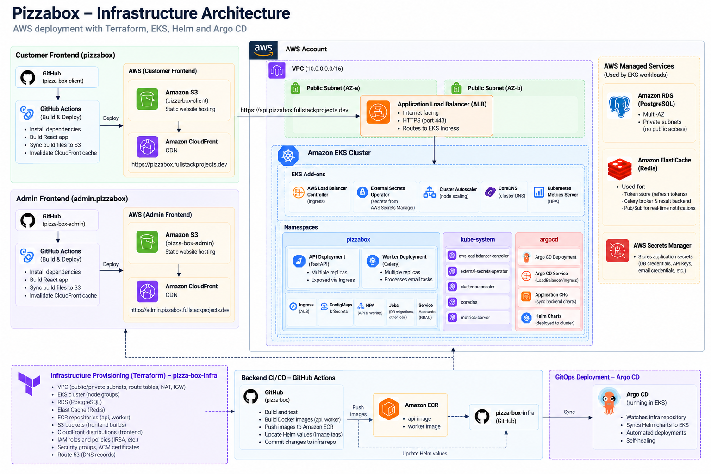
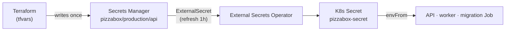
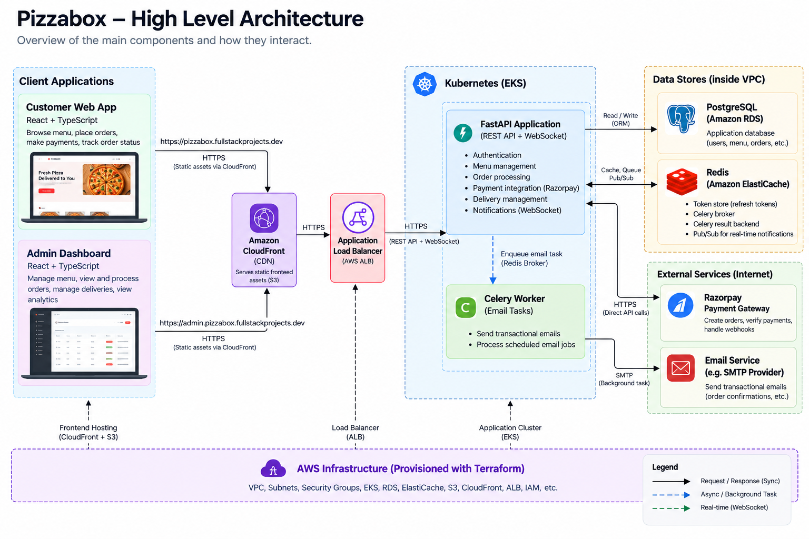
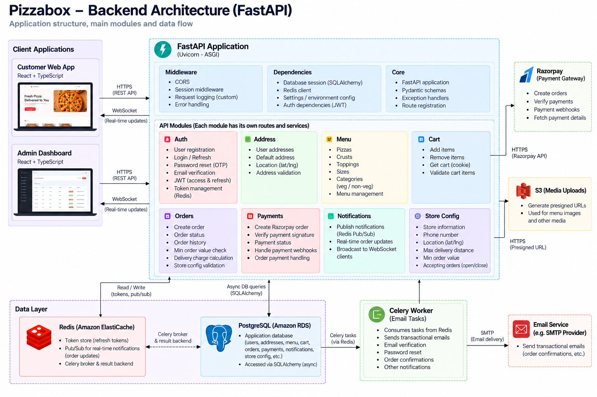
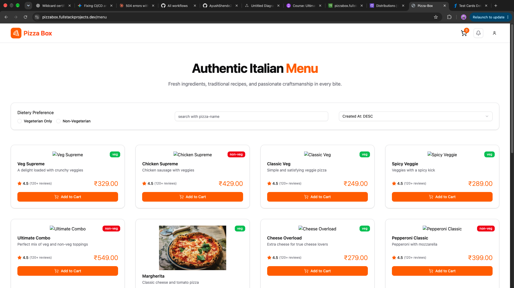
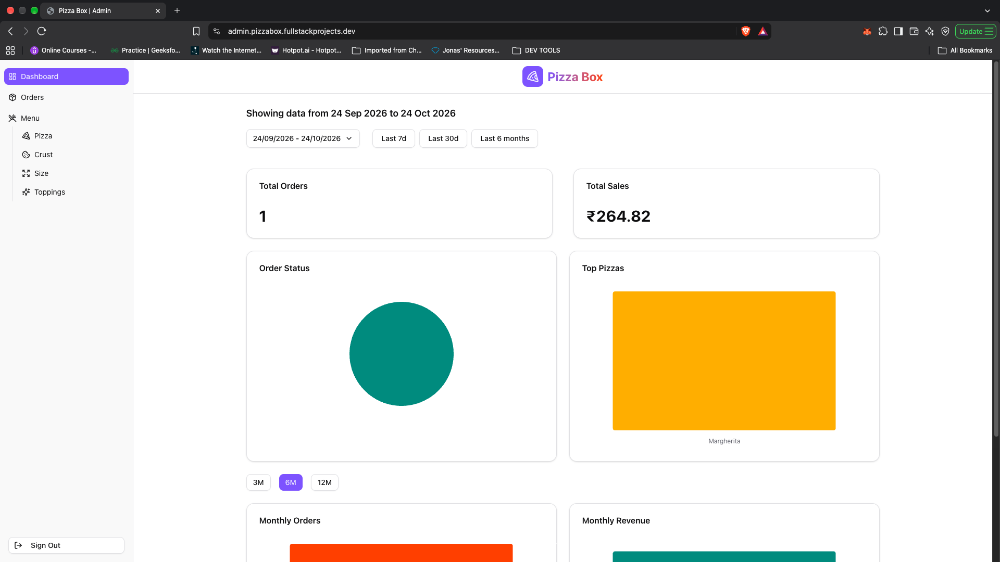

# Pizza Box — Infrastructure

Infrastructure-as-code and GitOps configuration for **Pizza Box**, a full-stack pizza ordering platform. This repository provisions everything on **AWS** with **Terraform**, packages the backend as a **Helm** chart, and keeps the cluster in sync with **Argo CD**.

| Site | URL | Served by |
|---|---|---|
| Customer app | <https://pizzabox.fullstackprojects.dev> | CloudFront → S3 |
| Admin dashboard | <https://admin.pizzabox.fullstackprojects.dev> | CloudFront → S3 |
| API | <https://api.pizzabox.fullstackprojects.dev> | Route 53 → ALB → EKS |
| Media (images) | <https://media.pizzabox.fullstackprojects.dev> | CloudFront → S3 |

---

## Table of contents

- [The Pizza Box ecosystem](#the-pizza-box-ecosystem)
- [Architecture](#architecture)
- [What Terraform provisions](#what-terraform-provisions)
- [GitOps with Argo CD](#gitops-with-argo-cd)
- [Helm chart](#helm-chart)
- [Configuration & secrets](#configuration--secrets)
- [Prerequisites](#prerequisites)
- [Bootstrap guide](#bootstrap-guide)
- [Tear-down](#tear-down)
- [Security highlights](#security-highlights)
- [Cost awareness](#cost-awareness)
- [Other Architecture Diagrams](#other-architecture-diagrams)

---

## The Pizza Box ecosystem

| Repository | Purpose |
|---|---|
| [`pizza-box`](https://github.com/AyushShende25/pizza-box) | FastAPI backend + Celery worker (built into the image deployed here) |
| [`pizza-box-client`](https://github.com/AyushShende25/pizza-box-client) | Customer SPA (deployed to S3/CloudFront) |
| [`pizza-box-admin`](https://github.com/AyushShende25/pizza-box-admin) | Admin SPA (deployed to S3/CloudFront) |
| **[`pizza-box-infra`](https://github.com/AyushShende25/pizza-box-infra)** *(this repo)* | Terraform, Helm chart, Argo CD applications |

---

## Architecture



**How the pieces fit**

- **Frontends** are static bundles in *private* S3 buckets, exposed only through CloudFront (Origin Access Control). `403/404` responses are rewritten to `/index.html` so client-side routing works.
- **The API** runs in EKS behind an internet-facing **ALB** created by the AWS Load Balancer Controller from a Kubernetes `Ingress`; **external-dns** creates the `api.…` Route 53 record automatically.
- **State** lives in managed services in private subnets: RDS PostgreSQL (Multi-AZ, encrypted) and ElastiCache Redis (encrypted in transit and at rest, auth token, automatic failover). Only the EKS node security group can reach them.
- **Secrets** are never stored in Git: Terraform writes them to **AWS Secrets Manager**, and the **External Secrets Operator** materialises them as a Kubernetes `Secret`.
- **AWS access from pods and CI** uses short-lived credentials only — IRSA for workloads and GitHub OIDC for pipelines.

---

## What Terraform provisions

Remote state is stored in S3 (`encrypt = true`, native lockfile locking). Default region is **`ap-south-1` (Mumbai)**; CloudFront certificates are created in `us-east-1`.

| Module | Resources & key settings |
|---|---|
| `vpc` | VPC; subnets typed **`public`**, **`application`**, **`database`** (driven by the `subnets` variable); Internet Gateway; **one NAT Gateway + EIP per public subnet**; application subnets route out through the NAT in *their own AZ*; database subnets have no internet route; subnets tagged for ELB / EKS discovery |
| `security-groups` | `alb` (80/443 from the internet), `eks-node` (API port 8000 from the ALB SG), `db` (5432 only from EKS nodes), `redis` (6379 only from EKS nodes) |
| `iam` | EKS cluster role and node role (worker, CNI, ECR read-only policies) |
| `eks` | Cluster **v1.35**, `API` authentication mode with an access entry + `AmazonEKSClusterAdminPolicy` for `admin_principal_arn`; managed node group `pizzabox-ng` (**t3.medium**, min 1 / desired 2 / max 4) from a launch template; OIDC provider; add-ons `vpc-cni`, `coredns`, `kube-proxy`, `metrics-server`; nodes tagged for the cluster autoscaler |
| `irsa` | IAM roles for service accounts: **cluster-autoscaler**, **external-secrets** (read the one secret), **aws-load-balancer-controller**, **external-dns** (Route 53 records), and **`pizzabox-uploader-role`** (S3 object access on the media bucket, bound to `pizzabox-app-ns/s3-uploader-serviceaccount`) |
| `rds` | PostgreSQL, **Multi-AZ**, gp3, `storage_encrypted`, not publicly accessible, 1-day backup retention |
| `elasticache` | Redis replication group (default engine 7.0, 2 nodes), **Multi-AZ + automatic failover**, TLS in transit, encryption at rest, AUTH token |
| `secrets-manager` | Secret `pizzabox/production/api` (JSON) holding connection strings and app secrets (see [below](#configuration--secrets)); |
| `ecr` | Repository **immutable tags** by default, scan-on-push |
| `s3` ×3 | `<domain>-client`, `<domain>-admin`, `<domain>-media-uploads` — all with **public access fully blocked**; the media bucket has CORS for the two frontends (GET/HEAD/PUT/POST/DELETE) so browsers can upload with presigned URLs |
| `cloudfront` ×3 | One distribution per bucket, **Origin Access Control** (SigV4), HTTPS-only redirect, TLS 1.2+ (SNI), IPv6, compression; the two SPAs get `index.html` as default root and 403/404 → `/index.html` |
| `acm` ×2 | `*.<domain>` wildcard in `ap-south-1` (for the ALB) and in `us-east-1` with the apex as SAN (for CloudFront), validated automatically through Route 53 |
| `route53` ×3 | Alias `A` records for `<domain>`, `admin.<domain>` and `media.<domain>` → CloudFront (the `api.` record is created by external-dns) |
| `github-actions-oidc` + `github-actions-role` ×3 | GitHub OIDC provider and three roles — `github-actions-api-ci` (ECR push), `github-actions-client-ci` and `github-actions-admin-ci` (S3 sync + CloudFront invalidation for *their own* bucket/distribution). Trust is limited to **`repo:AyushShende25/<repo>:ref:refs/heads/main`** |
| `helm` | Installs via the Helm provider: **AWS Load Balancer Controller** 3.5.0, **External Secrets Operator** 2.10.0, **external-dns** 1.21.1 (`policy=sync`, public zone only, scoped to the hosted zone), **Argo CD** (chart 10.8.1), **Cluster Autoscaler** 9.59.0 |

---

## GitOps with Argo CD

Terraform installs Argo CD but deliberately **not the application** — from then on, Git is the source of truth. The repo uses the *app-of-apps* pattern:


- **Ordering via sync waves:** AppProjects (−1) → `platform` (0: namespace, secret store, external secret, config) → `pizzabox` (1: the workload). Inside the chart, the migration Job is a **`PreSync` hook** (wave −1), so the database schema is upgraded *before* new pods roll out.
- Both applications use **automated sync with `prune` and `selfHeal`** — manual `kubectl` edits are reverted.
- **AppProjects restrict blast radius:** `pizzabox-project` may only deploy the listed namespaced kinds (Deployment, Service, ConfigMap, Secret, ServiceAccount, Job, Ingress, ExternalSecret, HPA) into `pizzabox-*` namespaces from this repo; `platform` may manage ClusterSecretStores, namespaces, ExternalSecrets and ConfigMaps.

---

## Helm chart

`helm/pizzabox` deploys the backend as two workloads from the **same image**:

| Component | Details |
|---|---|
| **API Deployment** | 2 replicas, port 8000; resources 250m/256Mi requests, 1 CPU/512Mi limits; **startup, liveness (`/health/live`) and readiness (`/health/ready`) probes**; topology-spread across zones and hosts; `/tmp` as an `emptyDir` |
| **HPA** | CPU target 70 %, 2 → 6 replicas |
| **Service** | `ClusterIP`, port 80 → 8000 |
| **Ingress** | `alb` class, internet-facing, `target-type: ip`, HTTP→HTTPS redirect, host `api.pizzabox.fullstackprojects.dev` |
| **Worker Deployment** | 2 replicas running `celery … worker --concurrency=2 --max-tasks-per-child=100`; liveness via `celery inspect ping` |
| **Migration Job** | Argo `PreSync` hook running `alembic upgrade head`; `backoffLimit: 1`, cleaned up after 6 min |
| **ServiceAccount** | `s3-uploader-serviceaccount`, annotated with the IRSA role so the API can sign S3 upload URLs |
| **Hardening** | `runAsNonRoot` (uid/gid 10001), `readOnlyRootFilesystem`, `allowPrivilegeEscalation: false`, all capabilities dropped |

Useful values (`helm/pizzabox/values.yaml`):

| Key | Purpose |
|---|---|
| `image.repository` / `image.tag` | ECR image. **`image.tag` is rewritten by the backend CI on every deploy** |
| `api.replicaCount`, `apiHpa.*` | API scale settings |
| `worker.replicaCount`, `worker.command` | Worker scale/command |
| `ingress.hosts`, `ingress.annotations` | Public hostname & ALB behaviour |
| `serviceAccount.annotations` | IRSA role ARN |
| `migration.enabled` | Toggle the PreSync migration Job |

> The ECR registry URL and IRSA role ARN in `values.yaml` contain the owner's AWS account ID — change them when forking.

Render locally with `helm template pizzabox helm/pizzabox --namespace pizzabox-app-ns`.

---

## Configuration & secrets

**Non-secret settings** are in `platform/configmap.yaml` (`pizzabox-config`): `APP_ENV`, `LOG_LEVEL`, public URLs (`BASE_URL`, `CLIENT_URL`, `ADMIN_URL` — also used by the API for CORS), JWT algorithm and token lifetimes, SMTP host/port/sender, and the media bucket name/region/CDN URL.

**Secrets** flow like this:



The secret JSON contains: `DATABASE_URL` (asyncpg), `REDIS_URL`, `CELERY_BROKER_URL`, `CELERY_RESULT_BACKEND` (Redis over TLS, DB 0/1/2), `JWT_SECRET_KEY`, `MAIL_USERNAME`, `MAIL_PASSWORD`, `RAZORPAY_KEY_ID`, `RAZORPAY_KEY_SECRET`, `SEED_ADMIN_PASSWORD`, `SEED_USER_PASSWORD`.

Things to know:

- The secret version has `lifecycle { ignore_changes = [secret_string] }`: Terraform sets it **once**. To rotate a value later, edit it in Secrets Manager (console/CLI), not in `terraform.tfvars`.
- Environment variables injected with `envFrom` are read at container start — after the ExternalSecret refreshes, **restart the pods** (`kubectl rollout restart deploy -n pizzabox-app-ns`) to pick up new values.
- The commented-out `externalSecret` / `configMap` blocks at the bottom of `values.yaml` are an earlier approach; the live equivalents are in `platform/`.

---

### GitHub configuration checklist

| Repo | Variables | Secrets |
|---|---|---|
| `pizza-box` | `AWS_GITHUB_ACTIONS_ROLE_ARN` | `INFRA_REPO_TOKEN` (write access to this repo) |
| `pizza-box-client` | `AWS_GITHUB_ACTIONS_ROLE_ARN`, `AWS_REGION`, `S3_BUCKET_NAME`, `DISTRIBUTION_ID`, `API_URL`, `VITE_PUBLIC_RAZORPAY_KEY_ID` | — |
| `pizza-box-admin` | `AWS_GITHUB_ACTIONS_ROLE_ARN`, `AWS_REGION`, `S3_BUCKET_NAME`, `DISTRIBUTION_ID`, `API_URL` | — |

`API_URL` is host + base path without scheme, e.g. `api.pizzabox.fullstackprojects.dev/api/v1`. The Terraform output `api_ci_role_arn` gives the backend role ARN; the client/admin role ARNs (`github-actions-client-ci`, `github-actions-admin-ci`) are visible in IAM.

---

## Prerequisites

- An **AWS account** and credentials able to create the resources above
- [Terraform](https://developer.hashicorp.com/terraform/install) **≥ 1.10** (needed for S3 native state locking), AWS CLI v2, `kubectl`, and optionally `helm`
- A **public Route 53 hosted zone** for your root domain (this repo expects `fullstackprojects.dev`; override `r53_hosted_zone`) — Terraform *looks it up*, it does not create it
- An **S3 bucket for Terraform state** matching `terraform/backend.tf` (`pizzabox.fullstackprojects.dev-remote-backend`), ideally with versioning enabled — create it first, or edit `backend.tf` to use your own
- The three application repos (`pizza-box`, `-client`, `-admin`) under the GitHub owner referenced by the `github_*_repo` variables

---

## Bootstrap guide

### 1. Configure variables

```bash
cd terraform
cp terraform.tfvars.example terraform.tfvars   # git-ignored
```

`terraform.tfvars` needs values for every variable without a default. A complete example:

```hcl
domain_name        = "pizzabox.fullstackprojects.dev"
r53_hosted_zone    = "fullstackprojects.dev"
vpc_cidr           = "10.0.0.0/16"

# Provide at least two AZs; types must be "public", "application" or "database".
# Each public subnet gets its own NAT gateway, and each application subnet uses the NAT of its AZ.
subnets = {
  "public-a"      = { cidr_block = "10.0.0.0/24",  availability_zone = "ap-south-1a", type = "public" }
  "public-b"      = { cidr_block = "10.0.1.0/24",  availability_zone = "ap-south-1b", type = "public" }
  "app-a"         = { cidr_block = "10.0.10.0/24", availability_zone = "ap-south-1a", type = "application" }
  "app-b"         = { cidr_block = "10.0.11.0/24", availability_zone = "ap-south-1b", type = "application" }
  "db-a"          = { cidr_block = "10.0.20.0/24", availability_zone = "ap-south-1a", type = "database" }
  "db-b"          = { cidr_block = "10.0.21.0/24", availability_zone = "ap-south-1b", type = "database" }
}

eks_cluster_name    = "pizzabox"
admin_principal_arn = "arn:aws:iam::<account-id>:user/<you>"   # becomes cluster admin

ecr_repository_name = "pizzabox-backend"   # must match ECR_REPOSITORY in the backend workflow

db_subnet_group_name = "pizzabox-db"
db_identifier        = "pizzabox"
db_name              = "pizzabox"
db_username          = "pizzabox"
db_password          = "<strong password>"
psql_version         = "17"
db_instance_class    = "db.t4g.micro"
db_allocated_storage = 20

redis_replication_group_name = "pizzabox-redis"
redis_subnet_group_name      = "pizzabox-redis"
redis_node_type              = "cache.t4g.micro"
redis_engine_version         = "7.0"
num_cache_clusters           = 2
redis_password               = "<16-128 chars, no @ / \" or spaces>"

env_var_jwt_secret_key      = "<openssl rand -hex 32>"
env_var_mail_username       = "<smtp user>"
env_var_mail_password       = "<smtp password>"
env_var_rzp_key_id          = "rzp_test_xxx"
env_var_rzp_key_secret      = "<razorpay secret>"
env_var_seed_admin_password = "<admin demo password>"
env_var_seed_user_password  = "<customer demo password>"
```

> Values above are placeholders/illustrative sizes — pick your own CIDRs and instance classes. `*.tfvars` is git-ignored: **never commit it**.

### 2. Apply Terraform

```bash
terraform init
terraform plan
terraform apply
```

First apply takes a while (EKS, RDS Multi-AZ, ElastiCache, CloudFront, ACM validation). Because the Helm provider is configured from the EKS module's outputs, if the very first run can't reach the cluster you can create it first with `terraform apply -target=module.eks` and then run a full `terraform apply`.

### 3. Connect to the cluster

```bash
aws eks update-kubeconfig --name <eks_cluster_name> --region ap-south-1
kubectl get nodes
```

### 4. Hand over to Argo CD

```bash
kubectl apply -f argocd/bootstrap/root-app.yaml
kubectl get applications -n argocd -w
```

The root app creates the projects, then `platform`, then `pizzabox`. Within minutes you should see the migration Job complete, API and worker pods running, an ALB provisioned and the `api.pizzabox.fullstackprojects.dev` DNS record created.

Optional — open the Argo CD UI:

```bash
kubectl -n argocd get secret argocd-initial-admin-secret -o jsonpath="{.data.password}" | base64 -d; echo
kubectl port-forward svc/argocd-server -n argocd 8080:443      # https://localhost:8080  (user: admin)
```

### 5. Seed the database (first deploy only)

The chart runs migrations but not seeding. Run the seed script once from an API pod (the `SEED_*` passwords are already in its environment from the secret):

```bash
kubectl exec -n pizzabox-app-ns deploy/pizzabox-api -- /app/.venv/bin/python -m app.utils.seed
```

### 6. Wire up GitHub and deploy the apps

Add the variables/secrets from the [checklist](#github-configuration-checklist) to each repo, then push to `main` (or run the workflow manually) in `pizza-box`, `pizza-box-client` and `pizza-box-admin`.

### 7. Smoke test

```bash
curl https://api.pizzabox.fullstackprojects.dev/health/ready     # {"status":"ready"}
```

Then open the customer and admin URLs and sign in with the seeded admin account (`admin@pizzabox.dev`).

---


## Tear-down

```bash
./scripts/teardown.sh
```

The script is ordered on purpose:

1. Scales the Argo CD application controller to 0 so it doesn't recreate resources
2. Deletes all Ingresses and waits, so the ALB is removed
3. Waits 60 s so **external-dns** can delete its Route 53 records
4. Deletes ExternalSecrets and ClusterSecretStores
5. Runs `terraform destroy --auto-approve`

---

## Security highlights

- **No long-lived cloud credentials:** GitHub Actions uses OIDC with trust limited to a specific repo and the `main` branch; pods use IRSA with one role per controller/workload
- **Least privilege:** the CI roles can only push to the one ECR repo or sync/invalidate their own bucket/distribution; the External Secrets role can read a single secret; the uploader role only touches the media bucket
- **Network isolation:** databases live in dedicated subnets with no internet route and accept traffic only from the EKS node security group; nodes sit in private application subnets
- **Encryption:** RDS and ElastiCache encrypted at rest; Redis TLS + AUTH; HTTPS-only CloudFront; ALB redirects HTTP → HTTPS
- **Private buckets:** all S3 buckets block public access; content is reachable only via CloudFront OAC
- **Hardened workloads:** non-root, read-only root filesystem, dropped capabilities, IMDSv2 required on nodes, ECR scan-on-push, immutable image tags
- **Secrets out of Git:** only references (`ExternalSecret`) are committed; `*.tfvars` and state are git-ignored

---

## Cost awareness

This is a production-style stack, not a free-tier one. The main recurring costs are the **EKS control plane**, **one NAT Gateway per AZ**, **Multi-AZ RDS**, a **multi-node ElastiCache** replication group, the **ALB**, and EC2 nodes. If you're experimenting, run `scripts/teardown.sh` when you're done, or reduce AZs/instance sizes in your `tfvars`.

---

## Other Architecture Diagrams










<sub>Part of the Pizza Box project — see [`pizza-box`](https://github.com/AyushShende25/pizza-box), [`pizza-box-client`](https://github.com/AyushShende25/pizza-box-client) and [`pizza-box-admin`](https://github.com/AyushShende25/pizza-box-admin).</sub>